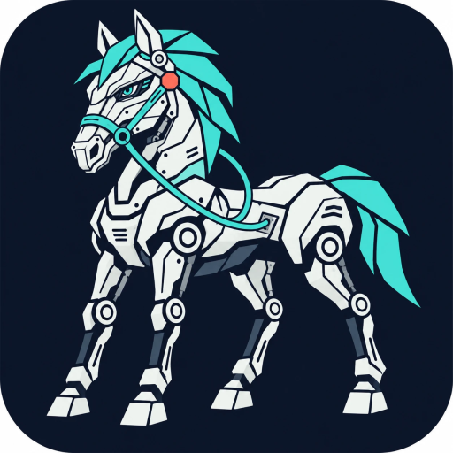
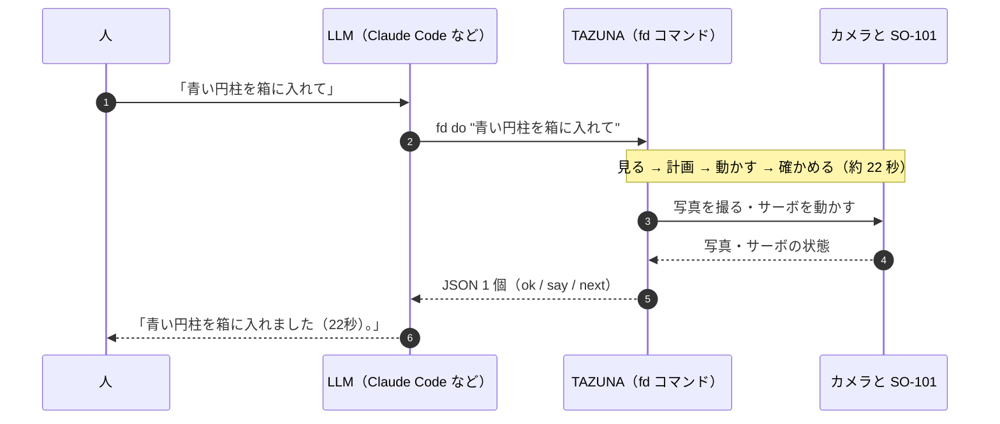
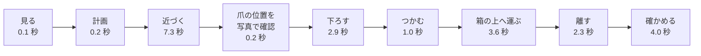
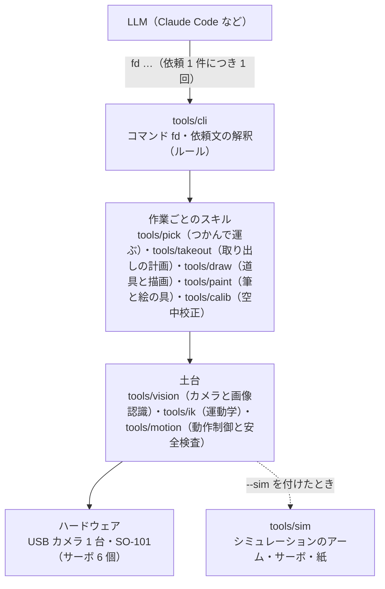

<p align="center">
  
  &nbsp;&nbsp;
  
</p>

<h1 align="center">TAZUNA</h1>

<p align="center">
  <b>TAZUNA Robotics Harness</b><br>
  Give AI the reins of robotics. — AI に、ロボットを操る手綱を
</p>

TAZUNA（手綱）は、**LLM がロボットを動かすためのハーネス**です。

LLM（Claude などの AI モデル）は、人の言葉を理解して段取りを考えるのは得意です。けれども、サーボを 1 つずつ動かす
細かい操作まで任せると、1 動作ごとに考える時間がかかって遅くなります。TAZUNA は LLM とロボットの間に入って、
**「依頼 1 件 = コマンド 1 回 = 結果の JSON 1 個」** にまとめます。見る・計画する・動かす・確かめる、という細かい仕事は
コマンドの中で済ませ、LLM には結果と「次にすること」だけを返します。

- **いま動くロボット**: SO-101（フォロワーアーム）1 台。Jetson Orin Nano Super と USB カメラ 1 台で動かしています。
- **目指していること**: SO-101、双腕ロボット、ヒューマノイドを、AI から同じやり方で動かせるようにすること。
- **いまの状況**: 「物を箱に入れる」は実機で動いています。「箱から取り出す」と「ペンで描く」は、シミュレーションと
  保存した写真での確認までです。2026-11-13 には、筆をグリッパーに留めて、水彩画を 2 枚、実機で描きました（赤べこ、雷門。
  その日の時点の `fd paint` と、その場で書いたスクリプトで）。その夜から翌朝にかけて、筆先の測定・爪の保持・紙の高さの
  測定などをコマンドにし、3 回の検証で見つかった所を直しましたが（`fd calib-air`、`fd tool jaw`、`fd paint contact` ほか）、
  **その夜に加えたコマンドは、実機では一度も動かしていません**（シミュレーションと、その日の保存写真だけ）。くわしくは [PROGRESS.md](PROGRESS.md) と、
  [docs/MANUAL.md](docs/MANUAL.md) の 11 章。

## プロンプトと、できたこと

人が AI に頼む言葉（プロンプト）と、そのとき TAZUNA で起きることです。ほかの例は [examples/](examples/) にあります。

| プロンプト（人 → AI） | AI が呼ぶコマンド | 結果 | 動画 |
|---|---|---|---|
| 青い円柱を箱に入れて | `fd do "青い円柱を箱に入れて"` | **実機で成功**（2026-11-11）。コマンドが返した `say` は「青い円柱を箱に入れました（22秒）。」で、AI はこれをそのまま人に伝えます | <a href="https://www.youtube.com/watch?v=vImrWLpaMcs&list=PLS2xQbZhQGBk"></a> |
| SO-101の先にマジックペンをつけました。猫の絵を描いてください | `fd tool attach …` → `fd tool calibrate` → `fd draw cat` | **実機ではこれから試します**（左のコマンドは、シミュレーションで確かめただけです）。動画の猫は、2026-11-11 にその場で書いた試作スクリプトで描いた 1 枚です（線 18 本、約 4 分。線は途切れがち）。そこで分かったことを組み込んだのが、左のコマンドです | <a href="https://www.youtube.com/watch?v=Fakua6h1_IE&list=PLS2xQbZhQGBk"></a> |
| 赤べこを水彩画で | `fd paint run PLAN --layer N`（赤 → 黒の順に、レイヤーごと。ほかに `fd paint look` / `locate` / `test` / `rinse`） | **絵は実機で描きました**（2026-11-13。平筆、赤 26 本・14 分と黒 8 本・3 分。白い所は紙の地です）。使ったのは、その日の版の `fd paint look / locate / test / run / rinse` です。プランは `tools/paint/paintings/akabeko.py` が書き出します。カメラを動かしたあとだったので、カメラの位置と筆先は、筆先を空中へ運んだ写真から、その場のスクリプトで測り直しました | <a href="https://www.youtube.com/watch?v=n0kHPno6wLo&list=PLS2xQbZhQGBk"></a> |
| 浅草雷門を水彩画で | `fd paint status`（次の一手を言う）→ `fd calib-air` → `fd paint contact` → `fd paint preview` → `fd paint run`（レイヤーごと） | **絵は実機で描きました**（2026-11-13。細い丸筆、8 層・70 本、時計で約 50 分）。そのときに使ったのは、その日の版の `fd paint look / locate / test / run / rinse` と、その場で書いたスクリプトです。スクリプトの部分をコマンドにしたのが左の手順で、**新しいコマンドは、実機ではこれから試します**（シミュレーションと保存した写真で確かめただけです。説明書の 11 章） | <a href="https://www.youtube.com/watch?v=cK-lYeAAcFo&list=PLS2xQbZhQGBk"></a> |
| 箱の中の白いキャップを取り出して | `fd do "箱の中の白いキャップを取り出して"` | シミュレーションで動作。実機ではこれから試します | — |

動画は YouTube の再生リスト [Tazuna](https://www.youtube.com/playlist?list=PLS2xQbZhQGBk) にまとめています。

## しくみ

### LLM とロボットの間に入る



- **LLM がすること**: 依頼の文をそのまま `fd do "…"` に渡し、返ってきた `say` を人に伝えます。うまくいかなかったときだけ、
  `stage`（どこで止まったか）・`reason`（理由）・`next`（次にすること）を読んで、もう 1 回コマンドを呼びます。
- **TAZUNA がすること**: 文を読む（ルールで読みます。ここでは LLM を使いません）→ 見る → 計画する → 動かす → 確かめる。
  読めない文や、否定・条件・質問の入った文は、ロボットを動かさずに LLM へ返します。
- **まとめる理由**: 1 動作ごとに LLM がコマンドを呼ぶ作りでは、時間の大半が「LLM の考える時間」でした。

| 1 個を箱に入れるとき（実機、2026-11-10〜11 の記録） | LLM の呼び出し | かかった時間 |
|---|---|---|
| 1 動作ごとに LLM がコマンドを呼ぶ（以前の作り） | 23〜28 回 | 267〜424 秒（うち 6〜7 割が LLM の考える時間） |
| TAZUNA（依頼 1 件 = コマンド 1 回） | 1 回（うまくいったとき） | コマンドの中で 18〜22 秒（成功を返した 3 回）。ほかに、LLM の呼び出し 1 回ぶんの時間 |

### 1 回のコマンドの中で起きること

`fd do "青い円柱を箱に入れて"` を実機で実行したとき（2026-11-11）の、段階ごとの時間です。合計 21.7 秒でした。



- **見る**: カメラの写真 1 枚から、机の上の物（色・形・大きさ・位置）と箱を見つけます。
- **計画**: つかみ方、通り道、置き場所を計算します。最初から最後までの通り道を先に全部検査し、通らない計画は実行しません。
- **動かす**: 関節の角度に直して（逆運動学）、サーボ 6 個を動かします。途中で 1 回、爪が写真のどこに見えるかを確かめます。
- **確かめる**: 離したあとにもう 1 枚撮り、物が元の場所から消えて箱の中に増えたことを確かめてから、結果を返します。

### 使っているもの

| 役割 | 使っているもの |
|---|---|
| 腕 | SO-101 フォロワーアーム（Feetech STS3215 サーボ 6 個、USB シリアル） |
| 目 | USB カメラ 1 台（Logitech C920、1920×1080）。ロボットの正面から、机を見下ろす向きに置きます |
| 計算機 | Jetson Orin Nano Super（Linux）。TAZUNA はこの上で動きます |
| AI | LLM（Claude Code）。`fd` コマンドを呼ぶ側です。TAZUNA の中では LLM を使いません |
| ソフトウェア | Python、numpy、OpenCV、feetech-servo-sdk、pyserial、`v4l2-ctl`（カメラの焦点と露出の固定）。画像認識・つかみ方の計画・運動学・動作制御は、このリポジトリの中のプログラムです |

### 安全のために、コードが必ず行うこと

- 動く前に、すべての通り道を検査します（関節の限界、机の面、立入禁止の範囲）。通らなければ動きません。
- 動いている間は、追従のずれ・サーボの異常・物への押し付けを見張り、異常があれば止めます。
- サーボには一時的な値（RAM）しか書きません。サーボに保存された校正は書き換えません。
- 否定や条件の入った依頼文（「〜しないで」「〜したら」など）は実行せず、LLM に返します。
- 腕を上げたままトルクを切ること、保存した写真で実機を動かすことは、コマンドが断ります。
- グリッパーに道具（ペン、筆）を登録している間は、道具を机に押し付けるおそれのあるコマンドを断ります。筆先を測っていない筆、
  紙の高さを測ったときと状態の違う筆では、描きません。ペンの校正は、筆には行いません。
- 実機のロック（`fd hw lock`）が掛かっている間は、サーボもカメラも開きません（`--sim` とテストは動きます）。
- その装置の設定ファイル（`config/config.json`）が無いとき、または測った値が入っていないときは、実機のアームを開きません。
- `--sim` を付けたコマンドは、装置の設定・校正のファイルも、本物のカメラの設定も書き換えません（書き換えるコマンドは断ります）。

実機を動かさずに試す方法が 2 つあります。`--sim` はシミュレーションのアームで実行し、`--dry` は計画だけを行います。
どちらも、保存した写真を `--frame` で渡さないと、本物のカメラを開きます（`--dry` だけのときは、関節を読むために
サーボとの通信も開きます）。コマンドの細部は [docs/MANUAL.md](docs/MANUAL.md) の 1 章、安全のための設計は 7 章にあります。

## フォルダ構成



| 場所 | 中身 |
|---|---|
| `fd` | 起動スクリプト（`tools/cli/fd.py` を呼びます） |
| [`tools/`](tools/) | プログラム。機能ごとのフォルダに分かれています（下の表） |
| [`tests/`](tests/) | テスト（19 ファイル、806 件。2026-11-14 夕方）と、テスト用のデータ。ロボットなしで動きます |
| [`examples/`](examples/) | プロンプト例（人が AI に頼む言葉、実行されるコマンド、返ってくる結果） |
| `config/` | その装置で測った設定と校正 |
| [`docs/`](docs/) | 説明書（[MANUAL.md](docs/MANUAL.md)）、組み込みの手順（[SETUP_SO101.md](docs/SETUP_SO101.md)）、設計メモ |
| `CLAUDE.md` | AI（Claude Code）向けの手順書 |

| `tools/` の中 | 機能 |
|---|---|
| `cli/` | コマンド `fd` と、依頼文の解釈 |
| `motion/` | 動作制御と安全検査、サーボとの通信、実機のロック（`fd hw`） |
| `ik/` | 運動学（関節の角度と指先の位置の変換。順運動学・逆運動学）、グリッパーの形 |
| `vision/` | カメラ、画像認識、カメラの校正モデル |
| `pick/` | つかんで運ぶスキル（箱に入れる・箱から取り出す）と、つかみ方の計画。待機・収納も |
| `takeout/` | 箱から取り出すときの、つかみ方と置き場所の計画 |
| `draw/` | グリッパーに付けた道具（ペン、筆）の登録、ペンの校正と線画の描画、可動爪に留めた道具の爪（`fd tool jaw`） |
| `paint/` | 筆と絵の具で描く（`fd paint`）: 筆の動きと深さの上限、絵の具と水、紙の高さの測定、レイヤーの実行、筆の模型と絵のプラン |
| `sim/` | 実機の代わりになるシミュレーション（サーボ、紙とペンとカメラ） |
| `calib/` | 空中校正（`fd calib-air`: 空中の写真から、道具の先端とカメラの位置を測る）と、校正を調べ直すときに手で実行するスクリプト |
| `publish/` | 公開する写真から、写っていた人を消す道具 |
| `prototypes/` | 2026-11-11 に書いた試作スクリプトの記録 |

## SO-101 に組み込む

リポジトリに入っている設定（`config/`）は、作者の装置 1 組で測った値です。**別の SO-101 では、下の手順で測り直すまで、
作業のコマンド（`fd do` / `pick` / `take` / `draw`）を実機で使わないでください。** 測り直しの途中では、低速で実機を動かします
（6 と 7）。流れは次のとおりです。手順の全部は [docs/SETUP_SO101.md](docs/SETUP_SO101.md) にあります（かっこの中は、その手順書の番号）。

1. **そろえる**（1）: SO-101 フォロワーアーム（サーボの ID と校正は LeRobot のセットアップなどで設定済みのもの）、Logitech C920、
   Linux の PC。カメラはロボットの正面に置き、作業する範囲と箱の全体が写るようにします。
2. **入れる**（2）: リポジトリを取り出し、Python のパッケージ（numpy、OpenCV、feetech-servo-sdk、pyserial）と `v4l2-ctl` を入れます。
3. **ロボットなしで試す**（3）: テストと、シミュレーションのコマンドを動かします（次の節）。
4. **作者の値を外す**（4）: 速度段を低速だけにし、カメラの校正ファイルをどけます。
5. **カメラと腕を確かめる**（5・6）: まだ動かしません。`fd snap --no-robot` でカメラの映りを、`fd state` と `fd selftest` で
   腕の値を見て、収納姿勢・グリッパーの範囲・立入禁止の範囲を設定します。
6. **初めて動かす**（7）: `fd torque on` → `fd ready` → `fd bench --tier slow`。待機姿勢での指先の位置を定規で確かめます。
7. **校正する**（8・9）: カメラ（`fd ref`、`fd calib-at`、`fd calib-fit`）、机の高さ、関節の原点を合わせます。
8. **最初の作業**（10・11）: カメラと腕の一致を確かめてから、`fd pick --dry`（計画だけ）→ `fd --sim do "…"`（シミュレーション）→
   `fd do "…"`（実機）の順に進めます。

この手順は作者の装置で行ったこととコードから組み立てたもので、別の個体で通して確かめたことはまだありません。
実機を動かすときは、人が見ている状態で、電源スイッチに手が届く場所で行ってください。

## ロボットなしで試す

サーボにもカメラにも触れずに動かせます。

```bash
git clone https://github.com/FaBoAI/Tazuna.git
cd Tazuna
python3 -m venv .venv && . .venv/bin/activate
pip install numpy opencv-python feetech-servo-sdk pyserial
```

（Ubuntu 23.04 以降などでは、システムの Python に直接 `pip install` できないので、仮想環境の中に入れます。）

保存した写真を見せて、シミュレーションのアームで「青いキューブを箱に入れて」を実行します。

```bash
./fd --sim do "青いキューブを箱に入れて" --frame tests/testdata/0148_cube_scene_raw.jpg
```

テストを全部実行します（依頼文の解釈の自己テストと、テスト 19 ファイル。Jetson Orin Nano Super で約 35 分: 2026-11-14 未明に
20 本を 1 本ずつ順に実行したときは 34.7 分で、20 本とも合格でした。そのあとの修正で、空中校正のテストが約 2 分長くなって
います。2026-11-13 の写真と記録を使うテストは、それがない場所では `SKIP` になります）。

```bash
python tests/run_all.py
```

`fd` が使う Python は、環境変数 `TAZUNA_PYTHON`、なければ `config/python` に書いたパス、どちらもなければ `python3` です。

## もっと詳しく

| 文書 | 内容 |
|---|---|
| [PROGRESS.md](PROGRESS.md) | 作業進捗。いまできること、実機で確かめたこと、まだできていないこと |
| [docs/MANUAL.md](docs/MANUAL.md) | 説明書。コマンドの細部、調整できる項目、実機確認の手順、安全のための設計、既知の課題。筆と絵の具、空中校正、爪、実機のロックは 11 章 |
| [docs/SETUP_SO101.md](docs/SETUP_SO101.md) | SO-101 に組み込む手順 |
| [examples/](examples/) | プロンプト例 |
| [CLAUDE.md](CLAUDE.md) | AI（Claude Code）がこのハーネスを使うときの手順書 |
| [docs/DESIGN.md](docs/DESIGN.md) | 設計メモ（英語） |

## ライセンス

Apache License 2.0（[LICENSE](LICENSE)）。同梱している他のプロジェクトのファイルは [NOTICE](NOTICE) にあります。

実物のロボットを動かすソフトウェアです。使う前に [docs/SETUP_SO101.md](docs/SETUP_SO101.md) と
[docs/MANUAL.md](docs/MANUAL.md) の 5 章・7 章を読んでください。
