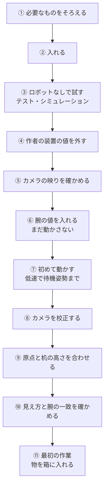

# SO-101 に TAZUNA を組み込む

自分の SO-101 で TAZUNA を動かすまでの流れです。概要は [README.md](../README.md)、コマンドの細部は [MANUAL.md](MANUAL.md) にあります。

> **先に知っておくこと**
>
> - この手順は、作者の装置 1 組（SO-101、Logitech C920、濃い赤茶色の机、5 V 電源）で行ったことと、コードの内容から
>   組み立てたものです。**別の個体で最初から最後まで通して確かめたことは、まだありません。**
> - 校正のコマンド（`ref`、`calib-at`、`calib-fit`、`calib-roll`）は 2026-11-10 に実機で使いましたが、その後コードを
>   直しており、いまの形では実機で動かしていません。
> - リポジトリの `config/config.json` には、作者のアームで測った値（関節の原点、指先の位置、机の高さ）が入っています。
>   **手順 9 で自分の値に直すまで、腕はその値で動きます。** 高さが 1〜2 cm ずれることがあるので、手順 7〜9 は低速で、
>   机に近づく動きは手順に書いた順に行ってください。
> - 実機が動く手順は、人が見ている状態で、電源スイッチに手が届く場所で、1 行ずつ行ってください。おかしいと思ったら
>   そこで止めてください。

## 全体の流れ



座標は、どの手順でもロボットのベース座標です（単位 m）。+x は前（カメラの方）、+y は左、+z は上です。原点は、肩の
回転軸の 38.8 mm 後ろ、ベースの底面（ほぼ机の面）にあります。

## 1. 必要なもの

| もの | 前提 | 決めている場所 |
|---|---|---|
| 腕 | SO-101 フォロワーアーム。サーボは Feetech STS3215 が 6 個、ID は 1〜6（肩の回転、肩、ひじ、手首の曲げ、手首の回転、グリッパーの順） | `tools/motion/servo_bus.py` |
| サーボの初期設定 | ID、通信速度、サーボの中に保存された校正（原点のずれと位置の上下限）は、LeRobot のセットアップなどで済ませておきます。TAZUNA はそれを読むだけで、書き換えるコマンドはありません | — |
| 接続 | USB シリアル `/dev/ttyACM0`、1,000,000 bps。変えるにはコードの定数を直します。リーダーアームも同じ ID なので、つないでいるのがフォロワーであることを手順 6 で確かめます | `tools/motion/servo_bus.py` の `PORT` |
| カメラ | Logitech C920 を 1 台、`/dev/video0`、1920×1080。焦点・露出・ホワイトバランスは `v4l2-ctl` で固定します | `tools/vision/camera.py` |
| カメラの置き場所 | ロボットの正面から、ロボットの方を見下ろす向き。作者の装置では、ベースの前方 0.55 m・高さ 0.29 m、下向き 約 33° です。作業する範囲と箱の全体が写るようにします | `config/camera_model.json`（測った結果） |
| 机 | ロボットが載っているのと同じ、平らな机の上で作業します。画像認識は「濃い赤茶色でつやのある机」と「白いグリッパー」を前提にしています。ほかの色では試していません | `tools/vision/scene.py`、`config/config.json` の `scene.*` |
| 電源 | 作者の装置は 5 V 電源で、動作中は 4.0〜4.1 V まで下がります。電圧のしきい値はこの電源に合わせた値です | `config/config.json` の `min_volt`、`bench.*` |
| PC | Linux。作者は Jetson Orin Nano Super（aarch64）、Python 3.13、numpy 2.5、OpenCV 4.13、feetech-servo-sdk 1.0、pyserial 3.5、v4l-utils。ほかの版は確かめていません | — |

## 2. 入れる

```bash
git clone https://github.com/FaBoAI/Tazuna.git
cd Tazuna
python3 -m venv .venv && . .venv/bin/activate
pip install numpy opencv-python feetech-servo-sdk pyserial
```

Ubuntu 23.04 以降や Debian 12 以降では、システムの Python に直接 `pip install` できません。上のように仮想環境（または conda の
環境）を作り、その中に入れてください。

実機のカメラを使うには、`v4l2-ctl` も要ります（焦点と露出の固定に使います。ロボットなしで試すだけなら不要です）。

```bash
sudo apt install v4l-utils
```

`fd` が使う Python は、環境変数 `TAZUNA_PYTHON`、なければ `config/python` に書いたパス、どちらもなければ `python3` です。
仮想環境を使うなら、パッケージを入れたその Python のパスを 1 行書いておきます。この文書の `python` も、同じ Python の
ことです（`tests/run_all.py` は、どの Python で起動しても、`fd` と同じ Python でテストを実行します）。確かめた組み合わせは、
Python 3.13 + numpy 2.5 + OpenCV 4.13（全テスト）と、Python 3.12 + numpy 1.26 + OpenCV 4.8（実行例と短いテスト 4 本）です。

```bash
which python > config/python
```

`CLAUDE.md` は作者の装置に合わせた AI 向けの手順書です。AI に実機のコマンドを実行させる前に、パスと数値を自分の装置に
合わせて直してください。

## 3. ロボットなしで試す

どれもサーボにもカメラにも触れません。

```bash
python tests/run_all.py
```

```bash
./fd --sim scene --frame tests/testdata/0148_cube_scene_raw.jpg
```

```bash
./fd --sim do "青いキューブを箱に入れて" --frame tests/testdata/0148_cube_scene_raw.jpg
```

- `--sim` はシミュレーションのアームを使います。`--frame` で保存した写真を渡さないと、**本物のカメラを開いて**焦点と露出を
  固定します（サーボには触れません）。
- `--dry` は見て計画するだけで、動かしません。`--sim` を付けないと、シリアルポート（関節の読み取り）とカメラは開きます。
- 設定や校正のファイルを書き換えるコマンド（`config --set`、`calib-fit`、`calib-roll`、`table-fit`、`ref`）と、カメラの設定を
  変える `camera` は、`--sim` を付けると断ります。`--sim` は「装置のものには触れない」という意味だからです。

## 4. 作者の装置の値を外す

リポジトリの `config/` には作者の装置で測った値が入っています。実機のコマンドを使う前に、次のことをします。

1. 使える速度段を、いちばん遅い段だけにします（作者の装置で合格した段が入っているため）。

   ```bash
   ./fd config --set 'speed_tier="slow"' 'speed_tiers_validated=["slow"]'
   ```

2. `config/camera_model.json`、`config/calib_points.json`、`config/probes.json` を別の場所へ移します。理由は 2 つあります。
   `calib-at` は `calib_points.json` と `probes.json` に追記するので、作者の点が残っていると混ざります。
   `camera_model.json` が残っていると、作者のカメラ位置から予測した場所の近くだけで指先を探します。
   カメラモデルをどけている間、`fd scene` / `pick` / `take` / `do` は `camera_model.json is missing` と答えて断ります。
   手順 8 で自分のカメラモデルを保存すると、使えるようになります。
3. `config/config.json` をエディタで開き、`keepouts` の中の `cables`（作者の配線をよける範囲）の行を消すか、自分の配線に
   合わせます（`fd config --set` では、項目を消せません）。
4. `config/config.json` そのものは残します。このファイルが無いとき、または関節の原点などが入っていないとき、TAZUNA は
   実機のアームを開きません。残した中で、まだ作者の値のままなのは次の 4 つです。手順 9 で自分の値に直します。

   | 項目 | 作者の値 | 意味 |
   |---|---|---|
   | `zero_ticks` | 肩 2118.1、手首の回転 1944.6、ほかは 2047 | 関節の原点（サーボの目盛り） |
   | `tip_offset` | (−0.001, 0, 0.0068) | 指先の位置（グリッパーの基準点から。m） |
   | `table_z`、`table_plane` | −0.0015 | 机の高さ |
   | `floor_z` | −0.0055 | 指先がこれより下へ行く動きを断る高さ |

5. `config/` の 4 つのファイルは、git が管理しています。自分の値を入れたあとでリポジトリを更新する（`git pull`）ときは、先に
   `config/` を別の場所へコピーし、更新のあとで `git diff config/` を見て、自分の値が残っていることを確かめてください。
   `git checkout -- config` や `git stash` は、作者の装置の値に戻します。戻ったことに気づかないと、別の装置の校正で実機が動きます。

## 5. カメラの映りを確かめる

アームを開かずに 1 枚撮り、カメラの設定を自動に戻します。

```bash
./fd snap --no-robot --name view
```

```bash
./fd camera auto
```

作業する範囲と箱の全体が写っていること、明るすぎ・暗すぎでないことを見ます。露出の値は `tools/vision/camera.py` の定数です。

## 6. 腕の値を入れる（まだ動かさない）

腕の電源を入れ、畳んだ姿勢のままにします。テレオペは動かさないでください。

```bash
./fd state
```

6 個のサーボが答えれば、関節の生の値（`raw`）、角度（`q_deg`）、電圧、温度が返ります。答えないときは、どのサーボか、
ポートを誰が使っているかがメッセージに出ます。ここで 2 つ確かめます。

- **つないでいるのがこのフォロワーアームであること**: 関節を 1 つ、手で少し動かしてから、もう一度 `./fd state` を実行します。
  その関節の `raw` が変わっていれば、この腕です。変わらないときは、別の腕（リーダーなど）につながっています。
- **角度がおかしくないこと**: 畳んだ姿勢の `q_deg` は、作者の装置では 肩 約 −100°、ひじ 約 +86°、手首の曲げ 約 +68° です。
  何十度も違う関節があれば、サーボの校正か組み立てが違います。先へ進まないでください。

```bash
./fd selftest
```

`checks.servo_limits` に、サーボに保存されている位置の上下限が出ます。**手首の回転（wrist_roll）以外の関節で、下限が 0、
上限が 4095 になっていたら、その関節には動く範囲の制限がありません。** LeRobot の校正をやり直してから進めてください。
この時点では、結果の `ok` は `false` です（カメラモデルをどけているので `checks.scene` がエラーになり、`calibration_unchanged` も
別の個体では `false` です）。見るのは
`checks.bus` と `checks.servo_limits` です。

畳んだ姿勢の `raw` を収納姿勢として、グリッパーの上下限を開閉の範囲として設定します。

```bash
./fd config --set rest_raw.shoulder_pan=<raw> rest_raw.shoulder_lift=<raw> rest_raw.elbow_flex=<raw> rest_raw.wrist_flex=<raw> rest_raw.wrist_roll=<raw> gripper.closed_raw=<最小> gripper.open_raw=<最大>
```

コードの中にも、作者の値が 2 つ残っています。いま読んだ値に書き換えてください。

- `tools/cli/fd.py` の `REST_RAW`（収納姿勢。トルクを切ってよいかの判定に使います）
- `tools/cli/fd.py` の `cmd_selftest` にあるサーボの上下限（`selftest` の `calibration_unchanged` は、これと同じかどうかを
  答えます。別の個体では、書き換えるまで `false` になります）

配線や治具など、腕が入ってはいけない範囲があれば、動かす前に定規で測って設定します。

```bash
./fd config --set 'keepouts.<名前>=[xmin,xmax,ymin,ymax,zmin,zmax]'
```

## 7. 初めて動かす（低速）

ここから実機が動きます。手や物をアームの届く範囲（前方 約 35 cm）に置かないでください。

```bash
./fd torque on
```

1 回目は何も動かず、6 つの関節が `newly_enabled` に並びます。もう一度実行して、`newly_enabled` が空で、腕が動かない
ことを確かめます。

```bash
./fd ready
```

低速で待機姿勢へ動きます。関節の原点がまだ作者の値なので、**定規で確かめてください**: 指先は、原点から前へ 0.20 m
（肩の回転軸から約 0.16 m）、机の面から約 0.12 m の高さにあるはずです（作者の装置では、肩の原点が 6.25° ずれていたとき、
指先の高さが 10〜25 mm ずれました）。**高さが 10 mm 以上違うときは、先へ進まないでください。** 肩の原点を直してから、
`./fd ready` をやり直します（目盛り 1 つは 0.088° です）。

```bash
./fd config --set zero_ticks.shoulder_lift=<値>
```

```bash
./fd bench --tier slow
```

何も持たずに 6 つの動きをして、追従の様子を測ります（約 25 秒）。`pass: true` になることを確かめます。

次に、指先どうしが触れるときの値を確かめます。何も持たずに `./fd grasp` を実行し、結果の `pos_raw` を読みます。指先が
実際に触れているかも、目で見ます。2050 ± 5 でなければ、その値を設定します。

```bash
./fd config --set gripper_touch_raw=<値>
```

## 8. カメラを校正する

待機姿勢で基準の写真を撮り、グリッパーを閉じてから、机の上の数か所で指先を写します。校正点は 6 点以上必要です
（作者は約 10 か所で 15 点）。

```bash
./fd ref
```

```bash
./fd grip 0.04
```

```bash
./fd calib-at 0.17 0.0 --roll0 15
```

`calib-at X Y` は、閉じた指先を (X, Y) の上へ運び、机に触れるまで下ろします。そのあと 2 つの高さ（机の 12 mm 上と
60 mm 上）のそれぞれで、手首を 180° 回した 2 枚の写真を撮ります。高さごとに 1 点、1 回で最大 2 点を
`config/calib_points.json` に追記します。場所を前後・左右に散らして繰り返します。机に触れた高さ（結果の `table_z`）は、
実際より 3〜18 mm 深く出ます。机の高さの設定には使わないでください（手順 9）。

```bash
./fd calib-fit --dry
```

当てはめの誤差（`rms_px`）とカメラの位置を確かめてから、`--dry` を外して保存します（`config/camera_model.json`）。作者の
装置では 15 点で誤差 8.95 画素（約 3 mm）でした。6 点未満、または誤差が 20 画素を超えるときは保存しません。

うまくいかないとき:

| メッセージ | すること |
|---|---|
| `fingertip not detected` | 指先の後ろが白っぽい・反射している、基準の写真（`fd ref`）が無い（結果の `reference_photo` が `false`）。`tip_roi` / `tip_exclude` を自分の映りに合わせる |
| `out of reach` / `IK failed` | 近い場所か別の高さにする。`./fd check X Y Z --pitch 90` で、動かさずに届くか分かります |
| `torque is off` | `./fd torque on` |

## 9. 原点と机の高さを合わせる

**机の高さと関節の原点**は、指先が机に最初に触れる高さをカメラで見て確かめます（1 か所 約 30 秒、実機が動きます）。
このスクリプトは、設定の机の高さ（`table_z`）の少し上から、2 mm ずつ指先を下ろします。**自分の机の高さがまだ分からない
最初の 1 回は、`--above 0.03` を付けて、3 cm 上から始めてください**（付けないと 1 cm 上から始めるので、原点がずれていると
最初から机を押します）。探すのは、設定の `table_z` の 5 mm 下までです（`--below` で変えられます）。どの場所でも
`first touch at z = not found` と出るときは、机が設定より低いか、関節の原点が大きくずれています。手順 7 の定規の確認に戻ってください。

```bash
python tools/calib/visual_touch.py 0.18,-0.06 0.22,-0.07 0.26,-0.07 0.20,0.0 --above 0.03
```

どの場所でも同じ高さなら、原点はそろっています。ベースからの距離で高さが変わるなら、関節の原点がずれています。
このスクリプトは測るだけなので、結果は自分で設定します（`<Z>` は測った高さ）。

```bash
./fd config --set table_z=<Z> floor_z=<Z-0.004> 'table_plane=[<Z>,0.0,0.0]'
```

**手首の回転の原点**は、校正の写真から求められます。

```bash
./fd calib-roll --dry
```

結果の `delta_deg`（いまの原点からのずれ）と `rms_px` を見ます。`--dry` を外すと、`zero_ticks.wrist_roll` に保存します。
**保存は、いまの原点で撮った校正点に対して 1 回だけにしてください。** 同じ校正点でもう一度保存すると、補正が二重に
かかります。

ここは、まだ仕組みが足りないところです。

- 肩・ひじ・手首の曲げの原点（`zero_ticks.shoulder_lift` など）を求めるコマンドはありません。作者は、触れた高さがどの
  場所でも同じになるように、肩の原点を手で当てはめました（`./fd config --set zero_ticks.shoulder_lift=<値>`）。
- 原点を変えたあとは、校正点とカメラモデルが古くなります。`config/calib_points.json` を消して、8 をやり直してください。
- `fd probe` や `calib-at` で触れた高さは、実際より 3〜18 mm 深く出ます。`fd table-fit` はその値を使うので、机の高さには
  使わないでください（`table-fit` は、`--force` を付けないと保存しません）。

## 10. 見え方と腕の一致を確かめる

つかむ前に、カメラと腕が一致しているかを確かめます。開いた爪を物の 35〜40 mm 上で止め、爪の先と物を **同じ 1 枚の写真**で
見比べます。2〜3 か所で行い、5 mm より大きくずれるなら校正を見直してください。

```bash
./fd tip X Y Z
```

```bash
./fd snap --crop x0,y0,x1,y1 --scale 4 --plain
```

## 11. 最初の作業（物を箱に入れる）

[MANUAL.md](MANUAL.md) 5 章の順に進めます。要点だけ書きます。

| 順 | コマンド | 確かめること |
|---|---|---|
| 1 | `./fd selftest` | 何も動かない。サーボが答え、机の上の物が正しく見えている |
| 2 | `./fd pick --color <色> --dry` | 何も動かない。つかみ方（`grasp`）と経路（`plan`）が出る |
| 3 | `./fd --sim do "<依頼>"` | シミュレーションのアームで最後まで通る |
| 4 | `./fd torque on` を 2 回 | 2 回目に腕が動かない |
| 5 | `./fd ready` | 待機姿勢へ。関節の誤差が 1° 未満 |
| 6 | `./fd bench --tier slow` | `pass: true` |
| 7 | `./fd do "<依頼>"` | 最初の実作業。`say` と `timings` を読む |
| 8 | `./fd bench --tier slow_cruise --accept` | 合格した速度段だけが使えるようになる |
| 9 | `./fd park` | 畳んでトルクを切る。カメラを自動露出に戻す |

箱から取り出す（`fd take`）と、道具・描画（`fd tool …`、`fd draw`）は、作者の装置でもまだ実機で動かしていません。
初回は MANUAL.md 5 章の手順で、見ている状態で行ってください。

## 安全のために

- `fd torque off` は腕が落ちます。終わるときは `fd park`（道具が付いているときは `fd tool rest`）を使います。
- グリッパーに何かを付けたら、動かす前に `fd tool attach` で登録します（MANUAL.md 4 章）。
- TAZUNA の校正を済ませたあとは、LeRobot の校正をやり直さないでください（"use file" の問いにも答えません）。サーボの中の
  校正が書き換わると、TAZUNA の座標がすべて変わります。
- テレオペなど、ほかのプログラムが同じポートを使っている間は、実機のコマンドを実行しないでください。
- 設定ファイルや Python が見つからないとき、`fd` はどのコマンドも断ります（`fd torque off --force` も動きません）。その状態で
  腕を止めるには、電源スイッチを使います。
