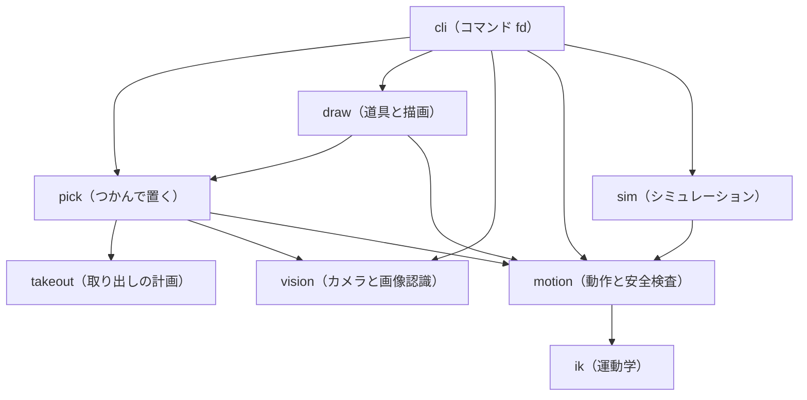

# tools — TAZUNA のプログラム

`tools/` には、コマンド `fd` の中身（Python のモジュール）が、機能ごとのフォルダに分かれて入っています。リポジトリ直下の `fd` は、使う Python を選んで `tools/cli/fd.py` を起動するスクリプトです。各フォルダの `README.md` に、ファイルの役割、ほかから呼ばれる入口、テスト、実機で確かめたかどうかを書いてあります。

| フォルダ | 何のためか | 主なファイル |
|---|---|---|
| [`cli/`](cli/README.md) | コマンド `fd` の本体。依頼文をルールで読む | `fd.py`、`nlq.py`、`fdtypes.py` |
| [`motion/`](motion/README.md) | アームを動かす。動く前と動いている間の安全検査。サーボとの通信 | `robot.py`、`servo_bus.py` |
| [`ik/`](ik/README.md) | 運動学（順運動学と逆運動学）と、グリッパーの形 | `kinematics.py`、`kinfast.py`、`gripper_model.py` |
| [`vision/`](vision/README.md) | カメラの撮影と、写真から机の上の物を見つける画像認識 | `camera.py`、`fastcam.py`、`scene.py`、`vision.py`、`blockfit.py`、`capfit.py` |
| [`pick/`](pick/README.md) | 「見る → 計画 → つかむ → 置く → 確かめる」を 1 回で行うスキル。つかみ方と放し方の計画 | `skills.py`、`grasp.py` |
| [`takeout/`](takeout/README.md) | 箱の中の物を取り出すときの、つかみ方と置き場所の計画 | `takeout.py` |
| [`draw/`](draw/README.md) | グリッパーに留めた道具（ペン）の登録と校正、線画の描画 | `tooling.py`、`penskill.py`、`ink.py`、`strokes.py`、`tracking.py`、`drawings/` |
| [`sim/`](sim/README.md) | 実機の代わりになるシミュレーション（サーボ、紙とペンとカメラ） | `sim_bus.py`、`phys_bus.py`、`fakebus.py`、`simpaper.py`、`sim_fuzz.py` |
| [`calib/`](calib/README.md) | 校正を調べ直すときに、手で実行するスクリプト | `kinfit.py`、`visual_touch.py`、`sheet.py` |
| [`publish/`](publish/README.md) | 公開する写真から、写っていた人を消す道具 | `privacy_wipe.py` |
| [`prototypes/`](prototypes/README.md) | 2026-11-11 に書いた試作スクリプトの記録（いまの構成では動きません） | `pen_draw/`、`stacking_20261111/` |

## フォルダどうしの関係



矢印は「元のフォルダのモジュールが、先のフォルダのモジュールを import する」という意味です。プログラムの import 文から作りました。図に描いたのは主な線だけで、次の線は省いています。

- `ik` は、`publish` を除く全部のフォルダから import されます。図には `motion` からの線だけを描きました。
- データ型の `cli/fdtypes.py` は、`vision`、`pick`、`sim` からも import されます。
- `calib` は、`vision`、`motion`、`ik`、`cli` を使う単体のスクリプトです。`publish` は、ほかのフォルダを import しません。`sim` の中では、`simpaper.py` が `vision/camera.py` を、調査用の `sim_fuzz.py` が `pick` を使います。
- 関数の中で、必要になったときだけ import する線もあります。`motion/robot.py` と `pick/skills.py` は `draw/tooling.py`（道具のファイルを読む）を、`pick/skills.py` は `sim/sim_bus.py`（シミュレーションかどうかの判定）を、`draw/penskill.py` は `--sim` のときに `sim/simpaper.py` を読み込みます。`vision` の `scene.py`、`blockfit.py`、`capfit.py` は、スクリプトとして実行したときだけ `motion/robot.py`（設定の読み込み）を使います。

## tazuna_paths.py — import のしくみ

モジュールは、フォルダ名を付けない名前のまま（`import robot`、`import kinematics`）、互いを import します。Python のパッケージには、まだしていないためです（[PROGRESS.md](../PROGRESS.md)「まだできていないこと」）。そこで `tools/tazuna_paths.py` が、機能フォルダ 10 個（`prototypes/` 以外）を `sys.path` に入れます。プロジェクトのフォルダ（`ROOT`）と `config/`（`CONFIG_DIR`）の場所も、このモジュールが教えます。自分のスクリプトからモジュールを使うときは、先頭に次の 3 行を置きます。そのあとは、どこから起動しても `import robot` や `import kinematics` が通ります。`tests/` のテストと、単体で実行するスクリプト（`sim/sim_fuzz.py` など）も、先頭で同じことをしています。

```python
import os, sys
sys.path.insert(0, os.path.join("<このリポジトリのフォルダ>", "tools"))
import tazuna_paths
```
